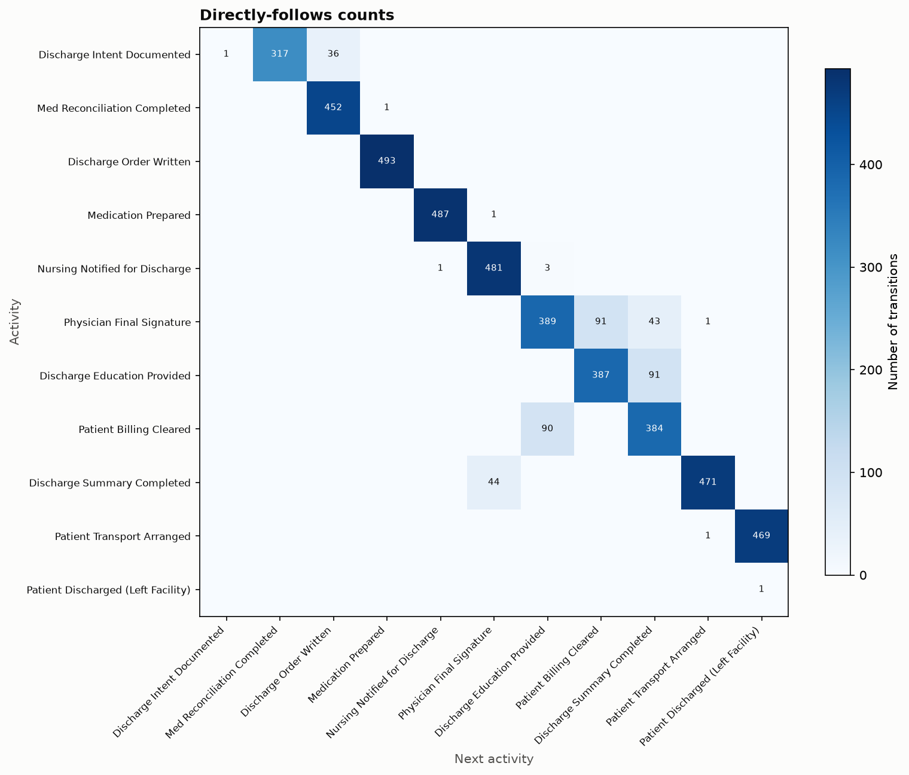
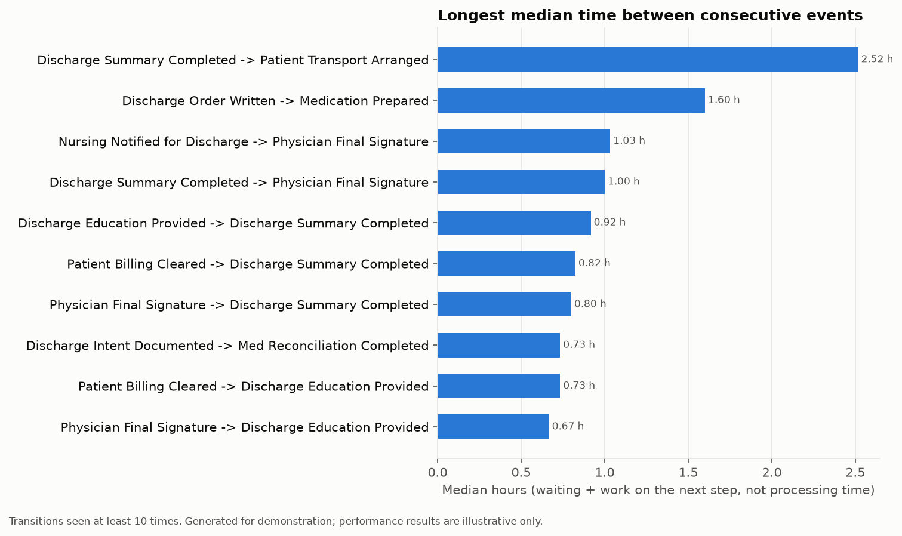

# Healthcare Process Mining: Hospital Discharge Workflow


A tested Python pipeline that reconstructs how hospital discharges actually flow (which steps happen, in which order, how much paths vary and where time goes) from an event log. It puts **data validation before analysis**.

> **Status of the data.** The original capstone dataset is no longer available, and in the original notebook its timestamps had been randomly generated. Everything that runs in this repository uses a clearly labelled **synthetic** dataset. Timing results shown here demonstrate the method; they are **not** findings about any hospital. See [docs/findings_and_limitations.md](docs/findings_and_limitations.md).

## Business problem

Discharge involves physicians, nursing, pharmacy, billing and transport. When it stalls, beds stay occupied and admissions back up. Written procedures say how discharge should run. Process mining shows how it really runs, using the timestamps hospital systems already record.

## What the project does

| Capability | Details |
|---|---|
| **Data-quality validation** | Counts missing or invalid case IDs, activities and timestamps, exact duplicates, timestamp ties, out-of-order rows, single-event cases and unknown activities. Each check states its rule and how affected rows are handled. |
| **Transparent cleaning** | Rejected rows are kept with a reason. Loaded = rejected + retained. Timestamps are never filled in or "fixed". |
| **Process discovery** | Activity frequencies and the Directly-Follows Graph (pandas, cross-checked against PM4Py); Petri nets with the Inductive or Heuristics Miner (PM4Py) |
| **Variant analysis** | Distinct paths, their frequency, cumulative coverage and rare variants |
| **Performance analysis** | Case durations and time between consecutive steps, in hours, ranked by median with a minimum-support threshold. Runs only when the timestamps can support it. |
| **Conformance checking** | A vocabulary check, then token-based replay against a reference sequence, plus simple precedence rules |
| **Reporting** | A Markdown report, CSV tables and charts, generated only from computed results |

## Example output (synthetic data)

| Directly-follows matrix | Slowest transitions (illustrative) |
|---|---|
|  |  |

On the synthetic data, the ranking recovers the generator's designed slowest steps: Transport 2.52 h, Medication Prepared 1.60 h and Physician Signature 1.03 h, against designed medians of 2.5 h, 1.5 h and 1.0 h. This is a **correctness check of the method**, and it is enforced by a unit test.

## Key results from the original capstone

| Finding | Status |
|---|---|
| 13,710 events, 2,500 cases, 11 activities; a near-linear path | **Verified** from recorded notebook output and the original frequency DFG ([image](outputs/figures/original_frequency_dfg.png)) |
| Negative case durations (average −48,477 s) | **Explained.** Timestamps were random, and PM4Py kept file order. Reproduced in a test. |
| Bottlenecks, waiting times, LOS 8.5 h → 6.4 h, 12% SOP compliance, 35% rework, ROI | **Not supported** by the data; no code produces them. Kept as proposals only. |
| Model fitness 1.00 | **Circular**: the model was discovered from and replayed on the same 108 cases |

Details: [docs/audit_report.md](docs/audit_report.md) · [docs/findings_and_limitations.md](docs/findings_and_limitations.md)

## Project structure

```
├── src/healthcare_process_mining/   reusable package (one module per analysis step)
├── tests/                           pytest suite (synthetic data built inside the tests)
├── notebooks/
│   ├── process_mining_analysis.ipynb   main walkthrough (executed)
│   └── archive/                        original capstone notebook, kept for traceability
├── data/sample/                     synthetic demo data (see data/README.md)
├── data/raw/                        your own extracts (gitignored)
├── outputs/                         generated reports and figures
├── docs/                            overview, methodology, data dictionary, findings, architecture, audit
└── .github/workflows/tests.yml      CI: tests + pipeline run
```

Module responsibilities and a data-flow diagram are in [docs/architecture.md](docs/architecture.md).

## Getting started

Requires Python 3.12 or newer. Tested with Python 3.14.6 on Windows 11.

```bash
git clone https://github.com/SwomBR/healthcare-process-mining.git
cd healthcare-process-mining
python -m venv .venv
# Windows: .venv\Scripts\activate    macOS/Linux: source .venv/bin/activate
pip install -r requirements-dev.txt
pip install -e .
```

Graphviz is **not** required. All charts use matplotlib. It is needed only for the optional PM4Py diagram functions in `visualization.py`.

### Run the analysis

```bash
# Synthetic demo data (writes outputs/reports/analysis_report.md and outputs/figures/)
python -m healthcare_process_mining --input data/sample/synthetic_discharge_events.csv --timestamps synthetic

# Your own data: put it in data/raw/ (gitignored) and state where the timestamps came from
python -m healthcare_process_mining --input data/raw/discharge_events.csv --timestamps original

# Timestamps known to be wrong: control-flow results only, timing is skipped
python -m healthcare_process_mining --input data/raw/discharge_events.csv --timestamps unreliable
```

Regenerate the synthetic sample with `python -m healthcare_process_mining.synthetic_data`. Open the walkthrough with `jupyter notebook notebooks/process_mining_analysis.ipynb` (install `jupyter` separately).

### Run the tests

```bash
pytest
```

The full suite (70 tests) runs in about 10 seconds. Use `pytest -m "not pm4py"` to run only the 54 tests that don't need PM4Py.

## Methodology highlights

- **Timestamp provenance is a required input** (`original` / `synthetic` / `unreliable`). It decides whether timing results are findings, illustrations, or are not produced at all.
- **Three time measures are kept apart:** case duration, the gap between consecutive steps (waiting plus work), and activity processing time. Processing time is not computed, because the data has only one timestamp per event.
- **Counting is done in pandas and modelling in PM4Py.** Simple counts stay transparent and independent of PM4Py's changing APIs (the original notebook broke on a removed variant function).
- **Conformance is framed honestly.** The reference sequence is the dominant observed path, not an approved SOP.

Full details: [docs/methodology.md](docs/methodology.md).

## Limitations

No real data is included. There is one timestamp per event, no independent SOP model, and no resource or ward attributes. See [docs/findings_and_limitations.md](docs/findings_and_limitations.md).

## Future improvements

- Re-run on a real extract with system timestamps (ideally start and end times per activity).
- Add an approved discharge SOP as an independent reference model, and use alignment-based conformance for richer diagnostics.
- Add resource and ward attributes to analyse staffing and hand-overs.
- Test the presentation's proposals (earlier pharmacy preparation, EHR hard-stops) against measured gaps.

## Skills demonstrated

Python packaging · pandas data wrangling · data-quality validation · process mining with PM4Py (DFG, Inductive/Heuristics Miner, token-based replay) · test design with pytest, including tests against known synthetic ground truth · reproducible pipelines and CI · technical writing that separates evidence from claims.

## Background and credits

This began as a four-member group capstone project, *"Using Process Mining Algorithms for Process Improvement in Healthcare"*. The original notebook is preserved in [notebooks/archive/](notebooks/archive/). The presentation is not included in the repository.

## License

No license has been chosen yet. Note that **PM4Py is licensed under AGPL-3.0**, which should be considered when choosing a license for this project.
