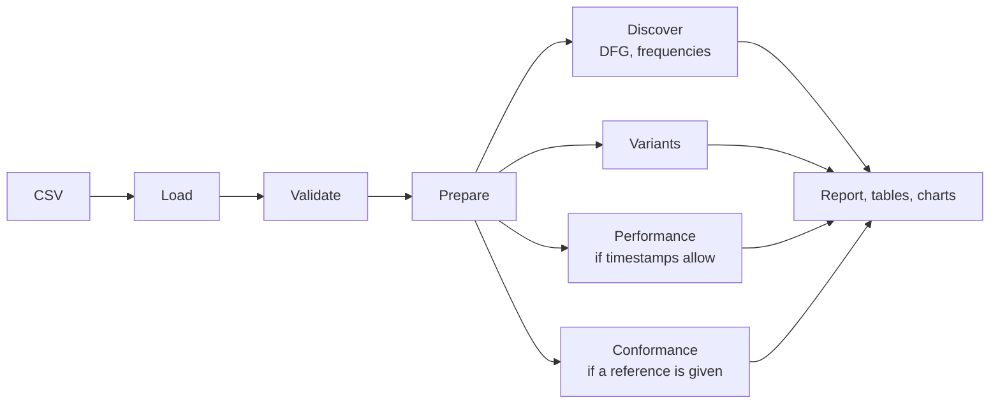

# Healthcare Process Mining: Hospital Discharge Workflow


A tested Python pipeline that reconstructs how hospital discharges actually flow (which steps happen, in which order, how much paths vary and where time goes) from an event log. It puts **data validation before analysis**.

> **Status of the data.** The original capstone dataset is no longer available, and in the original notebook its timestamps had been randomly generated. Everything that runs in this repository uses a clearly labelled **synthetic** dataset. Timing results shown here demonstrate the method; they are **not** findings about any hospital. See [docs/findings_and_limitations.md](docs/findings_and_limitations.md).

## Contents

1. [Business problem](#1-business-problem)
2. [What the project does](#2-what-the-project-does)
3. [Results](#3-results)
4. [Quick start](#4-quick-start)
5. [How the pipeline works](#5-how-the-pipeline-works)
6. [Usage](#6-usage)
7. [API reference](#7-api-reference)
8. [Outputs](#8-outputs)
9. [Data](#9-data)
10. [Configuration](#10-configuration)
11. [Testing](#11-testing)
12. [Project structure](#12-project-structure)
13. [Limitations and future work](#13-limitations-and-future-work)
14. [Skills demonstrated](#14-skills-demonstrated)
15. [Background, credits and license](#15-background-credits-and-license)

---

## 1. Business problem

Discharging a patient involves physicians, nursing, pharmacy, billing and transport. When discharge stalls, beds stay occupied and new admissions back up. Written procedures describe how discharge *should* run. **Process mining** reconstructs how it *actually* runs, using the timestamps that hospital systems already record for every step.

Typical questions:

- What is the usual path through discharge, and how many cases deviate from it?
- Which hand-overs take the longest?
- Do cases follow the intended order of steps?

Process mining answers these only if the event data is trustworthy, so this project **validates the data first** and refuses to report timing results that the timestamps cannot support.

## 2. What the project does

| Capability | Details |
|---|---|
| **Data-quality validation** | Counts missing or invalid case IDs, activities and timestamps, exact duplicates, timestamp ties, out-of-order rows, single-event cases and unknown activities. Each check states its rule and how affected rows are handled. |
| **Transparent cleaning** | Rejected rows are kept with a reason. Loaded = rejected + retained. Timestamps are never filled in or "fixed". |
| **Process discovery** | Activity frequencies and the Directly-Follows Graph (pandas, cross-checked against PM4Py); Petri nets with the Inductive or Heuristics Miner (PM4Py) |
| **Variant analysis** | Distinct paths, their frequency, cumulative coverage and rare variants |
| **Performance analysis** | Case durations and time between consecutive steps, in hours, ranked by median with a minimum-support threshold. Runs only when the timestamps can support it. |
| **Conformance checking** | A vocabulary check, then token-based replay against a reference sequence, plus simple precedence rules |
| **Reporting** | A Markdown report, CSV tables and charts, generated only from computed results |

## 3. Results

### 3.1 Example output (synthetic data)

| Directly-follows matrix | Slowest transitions (illustrative) |
|---|---|
|  |  |

From a run on `data/sample/synthetic_discharge_events.csv`:

| Measure | Value |
|---|---|
| Rows loaded / rejected / analysed | 5,243 / 8 / 5,235 |
| Rejected by reason | 3 missing timestamps, 2 invalid timestamps, 2 missing activities, 1 missing case ID |
| Exact duplicates (flagged, kept) | 4 |
| Cases / variants | 500 / 41 |
| Most frequent variant | 43.4% of cases; top 10 cover 90.6% |
| Median case duration | 10.03 h (synthetic) |
| Token-based replay against the reference sequence | 43.4% of cases fit perfectly; log fitness 0.930 |

**Method check.** The synthetic generator has designed median waits of 2.5 h before *Patient Transport Arranged*, 1.5 h before *Medication Prepared* and 1.0 h before *Physician Final Signature*. The pipeline recovers them as 2.52 h, 1.60 h and 1.03 h, in the same order, and a unit test enforces this. It shows the calculations are correct; it says nothing about a real hospital.

### 3.2 The original capstone

| Finding | Status |
|---|---|
| 13,710 events, 2,500 cases, 11 activities; a near-linear path | **Verified** from recorded notebook output and the original frequency DFG ([image](outputs/figures/original_frequency_dfg.png)) |
| Negative case durations (average −48,477 s) | **Explained.** Timestamps were random, and PM4Py kept file order. Reproduced in a test. |
| Bottlenecks, waiting times, LOS 8.5 h → 6.4 h, 12% SOP compliance, 35% rework, ROI | **Not supported** by the data; no code produces them. Kept as proposals only. |
| Model fitness 1.00 | **Circular**: the model was discovered from and replayed on the same 108 cases |

Details: [docs/audit_report.md](docs/audit_report.md) · [docs/findings_and_limitations.md](docs/findings_and_limitations.md)

## 4. Quick start

Requires **Python 3.12 or newer**. Tested locally with Python 3.14.6 on Windows 11, and in GitHub Actions with Python 3.12 and 3.14 on Ubuntu.

```bash
git clone https://github.com/SwomBR/healthcare-process-mining.git
cd healthcare-process-mining
python -m venv .venv
# Windows: .venv\Scripts\activate    macOS/Linux: source .venv/bin/activate
pip install -r requirements-dev.txt
pip install -e .

pytest                                                       # 70 tests, ~10 s
python -m healthcare_process_mining --timestamps synthetic   # full analysis on the sample data
```

The report is written to `outputs/reports/analysis_report.md` and the charts to `outputs/figures/`.

Graphviz is **not** required. All charts use matplotlib. It is needed only for the two optional PM4Py diagram functions in `visualization.py`.

## 5. How the pipeline works



**Step 1: Load** (`data_loader`). The CSV is read with every column as text, so nothing is silently converted (a case ID like `00123` keeps its zeros).

**Step 2: Validate** (`data_validation`). Every data-quality check runs and is reported, including checks that find zero problems. Validation never changes the data. Missing columns or an empty file stop the pipeline with a clear error.

**Step 3: Prepare** (`data_preparation`). Columns are renamed to internal names, timestamps are parsed, and rows are rejected by named rules: missing case ID, missing activity, and missing or invalid timestamp. Each rejected row is kept with its reason and its original timestamp text. Events are then ordered within each case:

- `timestamp` (default): by time, with ties kept in file order;
- `file_order`: as written in the file. Use this only when the timestamps are known to be wrong.

**Step 4: Discover** (`process_discovery`). Activity frequencies and the Directly-Follows Graph are counted with pandas. Petri nets can be discovered with PM4Py.

**Step 5: Variants** (`variant_analysis`). Cases with identical activity sequences are grouped and counted.

**Step 6: Performance** (`performance_analysis`). This step runs only when timestamps are `original` or `synthetic` **and** events are ordered by timestamp. It computes case durations and the gaps between consecutive events, in hours. Invalid values are excluded from statistics but counted. Only transitions seen at least 10 times are ranked.

**Step 7: Conformance** (`conformance_checking`). The pipeline first checks that the log and the reference model use the same activity names, then replays each case on the model with token-based replay.

**Step 8: Report** (`reporting`, `visualization`). All results are written as a Markdown report, CSV tables and PNG charts.

### Timestamp provenance

The single most important input is `timestamp_provenance`. It records where the timestamps came from:

| Value | Meaning | Timing analysis | Default ordering |
|---|---|---|---|
| `original` | Recorded by the source system | Computed; reported as findings | `timestamp` |
| `synthetic` | Generated for demonstration | Computed; labelled "illustrative only" | `timestamp` |
| `unreliable` | Known to be wrong (e.g. randomly assigned) | Skipped; report says "Not established" | `file_order` |

The original analysis implicitly treated random timestamps as real. This parameter makes that assumption explicit.

### Three different time measures

| Measure | Definition | Available? |
|---|---|---|
| Case duration | Last event time minus first event time | Yes |
| Transition gap | Time from one event to the next in the same case (waiting + hand-over + work on the next step) | Yes |
| Activity processing time | Start to end of one activity | **No.** The data has only one timestamp per event. |

## 6. Usage

### 6.1 Command line

```bash
python -m healthcare_process_mining --timestamps {original,synthetic,unreliable} [options]
```

| Option | Default | Description |
|---|---|---|
| `--input PATH` | `data/sample/synthetic_discharge_events.csv` | Event-log CSV file |
| `--timestamps` | *(required)* | Timestamp provenance; see the table above |
| `--order-by {timestamp,file_order}` | depends on `--timestamps` | Event ordering within cases |
| `--output DIR` | `outputs` | Output folder (`reports/` and `figures/` are created inside) |
| `--drop-duplicates` | off | Remove rows identical in case, activity and timestamp |
| `--no-conformance` | off | Skip conformance checking |

Examples:

```bash
# Your own extract with real system timestamps
python -m healthcare_process_mining --input data/raw/discharge_events.csv --timestamps original

# Timestamps known to be wrong: control-flow results only
python -m healthcare_process_mining --input data/raw/discharge_events.csv --timestamps unreliable

# Regenerate the synthetic sample (seed 42)
python -m healthcare_process_mining.synthetic_data
```

The command prints the record counts and the report location:

```
Loaded 5,243 rows, rejected 8, analysed 5,235.
Report: .../outputs/reports/analysis_report.md
```

### 6.2 Python

```python
from healthcare_process_mining import config
from healthcare_process_mining.pipeline import run_analysis, write_outputs

results = run_analysis(
    "data/sample/synthetic_discharge_events.csv",
    timestamp_provenance="synthetic",
    reference_activities=config.EXPECTED_ACTIVITIES,
)

print(results.preparation.counts)        # {'loaded': 5243, 'rejected': 8, 'retained': 5235, ...}
print(results.validation.to_frame())     # one row per data-quality check
print(results.variants.head())           # most frequent paths
print(results.duration_summary)          # None if timing analysis was skipped

write_outputs(results, "outputs")        # report, CSV tables, charts
```

Individual steps can also be used on their own:

```python
from healthcare_process_mining.data_loader import load_event_data
from healthcare_process_mining.data_preparation import prepare_event_log
from healthcare_process_mining.performance_analysis import case_durations, summarize_durations

raw = load_event_data("data/sample/synthetic_discharge_events.csv")
prepared = prepare_event_log(raw, timestamp_format="%Y-%m-%d %H:%M:%S")
summary = summarize_durations(case_durations(prepared.events))
```

### 6.3 Notebook

[notebooks/process_mining_analysis.ipynb](notebooks/process_mining_analysis.ipynb) is an executed, step-by-step walkthrough of the whole analysis, including a three-event example that reproduces the original negative-duration bug. Open it with `jupyter notebook notebooks/process_mining_analysis.ipynb` (install `jupyter` separately).

## 7. API reference

All modules live in `src/healthcare_process_mining/`. Docstrings follow the Google style; the full versions are in the source. Internal column names are `case_id`, `activity` and `timestamp` (see [Configuration](#10-configuration)).

### 7.1 `data_loader`

```python
def load_event_data(file_path: str | Path) -> pd.DataFrame:
    """Load event records from a CSV file.

    All values are read as text; headers are stripped of surrounding spaces,
    and files with a UTF-8 byte-order mark are accepted.

    Args:
        file_path: Path to the source CSV file.

    Returns:
        A DataFrame with one row per record. Empty cells are NaN.

    Raises:
        FileNotFoundError: If the file does not exist.
        ValueError: If the extension is not .csv, or the file is empty.
    """
```

### 7.2 `data_validation`

```python
def validate_event_log(df: pd.DataFrame,
                       expected_activities: list[str] | None = None,
                       timestamp_format: str | None = None) -> ValidationReport:
    """Run all data-quality checks on an event table. Never modifies the data.

    Args:
        df: Event table with internal column names, in source-file order.
        expected_activities: Known activity names; others are reported as
            unexpected. None skips that check.
        timestamp_format: Optional strftime format, e.g. "%Y-%m-%d %H:%M:%S".

    Returns:
        A ValidationReport. Check `report.has_blocking_errors` before continuing.
    """

class ValidationReport:
    """Results of all checks.

    Attributes:
        n_rows, n_cases: Size of the table inspected.
        missing_columns: Required columns that are absent.
        issues: list[ValidationIssue], one per check (check, count, unit, rule, handling).
        unexpected_activities: {activity name: row count} for unknown names.

    Properties / methods:
        has_blocking_errors: True if columns are missing or there are no rows.
        get(check) -> int: Count for a named check (0 if not run).
        to_frame() -> DataFrame: The issues as a table.
    """

def find_missing_columns(df, required) -> list[str]:
    """Required column names that are not present in df."""

def is_blank(series) -> pd.Series:
    """Mask of values that are missing or whitespace only."""

def find_invalid_timestamps(series, timestamp_format=None) -> pd.Series:
    """Mask of values that are present but cannot be parsed as dates.
    Missing values are not counted here; they are reported separately."""

def find_order_conflicts(df, timestamp_format=None) -> pd.Series:
    """Per case: True if, in file order, any event is earlier than the one
    recorded before it. The root cause of the original negative durations."""
```

Checks reported: `missing_case_id`, `missing_activity`, `missing_timestamp`, `invalid_timestamp`, `exact_duplicate`, `same_timestamp_in_case`, `case_order_conflict`, `single_event_case`, `unexpected_activity`. Their rules and handling are listed in [docs/data_dictionary.md](docs/data_dictionary.md).

### 7.3 `data_preparation`

```python
def prepare_event_log(raw: pd.DataFrame,
                      order_by: str = "timestamp",
                      drop_exact_duplicates: bool = False,
                      timestamp_format: str | None = None,
                      column_map: dict[str, str] | None = None) -> PreparationResult:
    """Clean and order raw event records.

    Rejection rules (each row gets the first that applies):
        1. missing_case_id
        2. missing_activity
        3. missing_timestamp / invalid_timestamp (only when order_by="timestamp")
        4. exact_duplicate (only when drop_exact_duplicates=True; first copy kept)

    Ordering:
        "timestamp": by case, then time; ties keep source-file order.
        "file_order": source row order within each case.

    Args:
        raw: Table as returned by load_event_data.
        order_by: "timestamp" or "file_order".
        drop_exact_duplicates: Remove rows identical in case, activity and timestamp.
        timestamp_format: Optional explicit timestamp format.
        column_map: Source-to-internal column names (default config.SOURCE_COLUMN_MAP).

    Returns:
        PreparationResult(events, rejected, counts, order_by), where
        `rejected` has `rejection_reason` and `timestamp_as_recorded` columns and
        `counts` holds loaded, rejected, retained and rejected_<reason>.

    Raises:
        ValueError: If required columns are missing or order_by is unknown.
    """

def standardize_columns(df, column_map=None) -> pd.DataFrame:
    """Rename source columns to internal names; returns a copy."""

def parse_timestamps(series, timestamp_format=None, utc=False) -> pd.Series:
    """Convert text to datetimes. Unparseable values become NaT (never guessed).
    Times are naive local time unless utc=True."""
```

### 7.4 `process_discovery`

```python
def activity_frequency(events) -> pd.DataFrame:
    """Per activity: event_count (all occurrences) and case_count (cases containing it)."""

def compute_dfg(events) -> pd.DataFrame:
    """Directly-Follows Graph as a table (source, target, count), counted within
    cases only. Verified equal to pm4py.discover_dfg in the tests."""

def start_end_activities(events) -> tuple[pd.Series, pd.Series]:
    """Counts of each case's first and last activity."""

def build_event_log(events) -> pm4py.objects.log.obj.EventLog:
    """Convert prepared events to a PM4Py EventLog, preserving their order.
    PM4Py keeps row order and does not re-sort by timestamp."""

def discover_petri_net(events, algorithm="inductive", noise_threshold=0.0):
    """Discover (net, initial_marking, final_marking) with the Inductive or
    Heuristics Miner. A discovered model describes what happened, not what
    should happen.

    Raises:
        ValueError: Unknown algorithm or empty event log.
    """
```

### 7.5 `variant_analysis`

```python
def variant_table(events) -> pd.DataFrame:
    """One row per variant, most frequent first: variant_id, activities (tuple),
    n_activities, case_count, case_pct, cumulative_pct. Ties are ordered by the
    activity sequence, so the ranking is reproducible."""

def variant_summary(table, rare_max_cases=1) -> dict:
    """n_cases, n_variants, top_variant_pct, top10_pct, n_rare_variants, rare_case_pct."""

def case_sequences(events) -> pd.Series:
    """Each case's activity sequence as a tuple, indexed by case ID."""

def format_variant(activities, max_length=0) -> str:
    """Readable "A > B > C" label, optionally truncated."""
```

### 7.6 `performance_analysis`

All durations are in **hours**.

```python
def case_durations(events) -> pd.DataFrame:
    """Per case: n_events, first/last activity, start, end, duration_hours,
    is_single_event, is_negative. Duration = last minus first event time in
    the given order (same definition as PM4Py's get_all_case_durations)."""

def summarize_durations(durations, value_column="duration_hours") -> dict:
    """Statistics over valid values only, with exclusions counted.

    Returns:
        n_total, n_valid, n_missing, n_negative, n_single_event,
        mean, median, p90, min, max (NaN if nothing is valid).
    """

def long_running_cases(durations, quantile=0.90) -> pd.DataFrame:
    """Valid cases above the given duration quantile, longest first.
    Raises ValueError if quantile is outside 0 to 1."""

def transition_gaps(events) -> pd.DataFrame:
    """One row per consecutive pair of events in a case: case_id, source,
    target, gap_hours. NOT activity processing time."""

def transition_gap_summary(gaps) -> pd.DataFrame:
    """Per (source, target): count, n_negative, median/mean/p90/max hours of
    non-negative gaps, sorted by median (robust to skew)."""

def slowest_transitions(gap_summary, min_count=10, top_n=10) -> pd.DataFrame:
    """Longest-median transitions observed at least min_count times. Rare
    transitions are excluded because they are often artefacts of rejected rows."""
```

### 7.7 `conformance_checking`

```python
def build_sequential_net(activities, name="reference_process"):
    """Petri net in which the activities must occur once each, in order.
    Returns (net, initial_marking, final_marking).
    Raises ValueError if activities is empty or has duplicates."""

def vocabulary_check(events, reference_activities) -> dict:
    """{"only_in_log": [...], "only_in_model": [...], "shared": [...]}.
    Run this first: if nothing is shared, conformance is meaningless."""

def token_replay(events, net, initial_marking, final_marking):
    """Token-based replay of every case.

    Returns:
        (metrics, per_case) where metrics has perc_fit_traces,
        average_trace_fitness and log_fitness, and per_case has case_id,
        is_fit, fitness, missing_tokens and remaining_tokens.
    """

def check_precedence(events, before, after) -> pd.DataFrame:
    """Per case containing `after`: has_before_earlier and violation
    (True when `after` happened without an earlier `before`)."""

def model_activities(net) -> set[str]:
    """Visible activity labels of a Petri net."""
```

### 7.8 `visualization`

Plot functions take already-computed tables and return a matplotlib `Figure`. No metric is calculated inside a plotting function.

```python
plot_activity_frequency(frequency)                               # bar chart
plot_variant_coverage(variants, top_n=10)                        # share of cases per variant
plot_case_duration_histogram(durations, summary, provenance_note="")
plot_transition_gaps(top, provenance_note="")                    # median gap per transition
plot_dfg_matrix(dfg, activity_order=None)                        # DFG as a from/to matrix
save_figure(fig, path, dpi=150) -> Path                          # save and close

graphviz_available() -> bool
save_dfg_diagram(dfg, starts, ends, path) -> Path                # needs Graphviz
save_petri_net_diagram(net, initial_marking, final_marking, path) -> Path  # needs Graphviz
```

The two diagram functions raise `RuntimeError` with installation instructions if Graphviz is missing.

### 7.9 `pipeline`

```python
def run_analysis(data, timestamp_provenance, order_by=None,
                 reference_activities=None, drop_exact_duplicates=False,
                 timestamp_format="%Y-%m-%d %H:%M:%S") -> AnalysisResults:
    """Run the full analysis on one event log.

    Args:
        data: Path to a CSV file, or an already loaded raw DataFrame.
        timestamp_provenance: "original", "synthetic" or "unreliable".
        order_by: "timestamp" or "file_order"; default depends on provenance.
        reference_activities: Ordered activities for the reference model;
            None skips conformance.
        drop_exact_duplicates: Passed to prepare_event_log.
        timestamp_format: Explicit format; None lets pandas infer it.

    Raises:
        ValueError: Unknown provenance, or blocking validation errors.
    """

def write_outputs(results, output_dir) -> dict[str, Path]:
    """Write CSV tables, PNG charts and analysis_report.md; returns the paths."""

class AnalysisResults:
    """source, timestamp_provenance, order_by, validation, preparation,
    activity_frequency, dfg, start_activities, end_activities, variants,
    variant_summary, case_durations*, duration_summary*, long_running_cases*,
    transition_gap_summary*, vocabulary**, conformance_metrics**,
    conformance_per_case**, notes.

    * None when performance analysis was skipped.
    ** None when conformance was skipped.
    performance_available: True if timing results exist.
    """
```

### 7.10 `reporting`

```python
def build_report(results) -> str:
    """Markdown report built only from AnalysisResults: record counts,
    data-quality table, process structure, performance (or "Not established"),
    conformance and limitations. Timing is labelled by provenance."""
```

### 7.11 `synthetic_data`

```python
def generate_clean_log(n_cases=500, seed=42) -> pd.DataFrame:
    """Seeded synthetic log with known rules: optional steps (30%, 10%),
    a swapped pair (20%), rework (12%), incomplete cases (5%) and log-normal
    gaps with the medians in TRANSITION_MEDIAN_MINUTES."""

def inject_quality_issues(clean, seed=42) -> tuple[pd.DataFrame, dict[str, int]]:
    """Add exactly 3 missing timestamps, 2 invalid timestamps, 2 missing
    activities, 1 missing case ID and 4 exact duplicates, then shuffle row
    order. Returns the data and the injected counts (ground truth for tests)."""

def write_sample_file(path=config.SYNTHETIC_SAMPLE_FILE, n_cases=500, seed=42) -> Path:
    """Generate and save the sample CSV."""
```

## 8. Outputs

`write_outputs` (and the command line) create:

| File | Contents | Created when |
|---|---|---|
| `reports/analysis_report.md` | Plain-language report | Always |
| `reports/data_quality_checks.csv` | One row per check: count, unit, rule, handling | Always |
| `reports/rejected_records.csv` | Every rejected row with its reason and original timestamp text | Always |
| `reports/activity_frequency.csv` | Events and cases per activity | Always |
| `reports/directly_follows.csv` | DFG edges with counts | Always |
| `reports/variants.csv` | All variants with counts and shares | Always |
| `reports/case_durations.csv` | One row per case | Performance analysis ran |
| `reports/transition_gaps.csv` | Gap statistics per transition | Performance analysis ran |
| `reports/conformance_per_case.csv` | Replay result per case | Conformance ran |
| `figures/activity_frequency.png`, `top_variants.png`, `dfg_matrix.png` | Charts | Always |
| `figures/case_duration_distribution.png`, `transition_gaps.png` | Charts | Performance analysis ran |

Generated reports are gitignored, because they can be regenerated with one command. The figures shown in this README are committed.

## 9. Data

### Input format

| Column | Required | Description |
|---|---|---|
| `Case ID` | Yes | One discharge encounter |
| `Activity` | Yes | Name of the step |
| `Timestamp` | Yes | `YYYY-MM-DD HH:MM:SS`, no timezone (treated as local clock time) |

### Available data

- **`data/sample/synthetic_discharge_events.csv`** is **synthetic**: 500 cases and 5,243 rows, with invented timings and deliberately injected data problems. See [data/README.md](data/README.md).
- **`data/raw/`** is for your own extracts and is **gitignored**. Never commit real patient data.
- **The original dataset** (13,710 rows, 2,500 cases) is not available. Its 11 activities and their counts are documented in [docs/data_dictionary.md](docs/data_dictionary.md).

### Activities (in the order of the original dominant path)

Discharge Intent Documented → Med Reconciliation Completed → Discharge Order Written → Medication Prepared → Nursing Notified for Discharge → Physician Final Signature → Discharge Education Provided → Patient Billing Cleared → Discharge Summary Completed → Patient Transport Arranged → Patient Discharged (Left Facility)

## 10. Configuration

Shared settings live in [`src/healthcare_process_mining/config.py`](src/healthcare_process_mining/config.py). No environment variables or machine-specific paths are needed; all paths are relative to the project root.

| Setting | Value | Purpose |
|---|---|---|
| `CASE_COL`, `ACTIVITY_COL`, `TIMESTAMP_COL` | `case_id`, `activity`, `timestamp` | Internal column names |
| `SOURCE_COLUMN_MAP` | `Case ID`/`Activity`/`Timestamp` → internal | Renaming input columns |
| `TIMESTAMP_FORMAT` | `%Y-%m-%d %H:%M:%S` | Explicit parsing (avoids day/month confusion) |
| `EXPECTED_ACTIVITIES` | the 11 activities above | Vocabulary check and reference sequence |
| `TIMESTAMP_PROVENANCE_OPTIONS` | original / synthetic / unreliable | Controls timing analysis |
| `LONG_RUNNING_QUANTILE` | 0.90 | Threshold for long-running cases |
| `MIN_TRANSITION_COUNT` | 10 | Minimum observations to rank a transition |
| `TOP_N` | 10 | Rows in "top N" tables and charts |

The package sets `PM4PY_SHOW_PROGRESS_BAR=False` on import (unless you have set it yourself) to keep notebook and report output clean.

## 11. Testing

```bash
pytest                    # all 70 tests, ~10 s
pytest -m "not pm4py"     # 54 tests that never import PM4Py, < 1 s
pytest tests/test_data_validation.py -v
```

Tests build small synthetic DataFrames inside the test code. No real data is needed. They cover:

- **Loading:** valid files, missing files, unsupported formats, empty files, byte-order marks and padded headers.
- **Validation:** each check, including missing versus invalid timestamps, duplicates versus legitimate rework, and out-of-order rows.
- **Preparation:** ordering, ties, rejection reasons, never filling missing timestamps, and the input left unmodified.
- **Performance:** hand-calculated durations, reproduction of the original negative-duration bug, exclusions, empty inputs and the rare-transition threshold.
- **Discovery:** DFG counts cross-checked against `pm4py.discover_dfg`, and PM4Py preserving event order.
- **Conformance:** vocabulary mismatches, fitting versus deviating cases, and precedence rules.
- **End to end:** the pipeline detects exactly the injected problems, record counts add up, the designed slowest step is recovered, and every output file is written.

GitHub Actions ([.github/workflows/tests.yml](.github/workflows/tests.yml)) runs the tests and the pipeline on every push with Python 3.12 and 3.14.

## 12. Project structure

```
healthcare-process-mining/
├── README.md
├── pyproject.toml                  package metadata and pytest settings
├── requirements.txt                pinned runtime dependencies
├── requirements-dev.txt            + pytest and notebook execution tools
├── .github/workflows/tests.yml     CI
├── src/healthcare_process_mining/
│   ├── __init__.py
│   ├── __main__.py                 command-line entry point
│   ├── config.py                   columns, paths, activities, thresholds
│   ├── data_loader.py              read CSV
│   ├── data_validation.py          data-quality checks
│   ├── data_preparation.py         cleaning rules and ordering
│   ├── process_discovery.py        frequencies, DFG, Petri nets
│   ├── variant_analysis.py         variants
│   ├── performance_analysis.py     durations and transition gaps
│   ├── conformance_checking.py     reference model and replay
│   ├── visualization.py            charts
│   ├── reporting.py                Markdown report
│   ├── pipeline.py                 orchestration
│   └── synthetic_data.py           synthetic demo data generator
├── tests/                          70 pytest tests
├── notebooks/
│   ├── process_mining_analysis.ipynb   main walkthrough (executed)
│   └── archive/original_capstone_analysis.ipynb
├── data/
│   ├── README.md
│   ├── sample/synthetic_discharge_events.csv
│   └── raw/                        your own data (gitignored)
├── outputs/figures/                charts used in this README
└── docs/
    ├── project_overview.md
    ├── methodology.md
    ├── data_dictionary.md
    ├── findings_and_limitations.md
    ├── architecture.md
    └── audit_report.md
```

### Dependencies

| Package | Version tested | Used for |
|---|---|---|
| pandas | 3.1.0 | All tabular processing |
| numpy | 2.5.4 | Synthetic data generation |
| matplotlib | 3.11.2 | Charts |
| pm4py | 2.7.23.11 | Event-log conversion, Petri-net discovery, token-based replay |
| pytest | 9.2.0 | Tests (dev only) |

## 13. Limitations and future work

**Limitations**

- No real data is included; all runnable results are synthetic.
- One timestamp per event, so activity processing time cannot be measured.
- No approved SOP is available, so conformance measures agreement with the usual path, not compliance.
- No resource, ward or patient attributes, so staffing and patient-mix effects cannot be analysed.

Full discussion: [docs/findings_and_limitations.md](docs/findings_and_limitations.md).

**Future work**

- Re-run on a real extract with system timestamps (ideally start and end times per activity).
- Add an approved discharge SOP as an independent reference model, and use alignment-based conformance for richer diagnostics.
- Add resource and ward attributes to analyse staffing and hand-overs.
- Test the presentation's proposals (earlier pharmacy preparation, EHR hard-stops) against measured gaps.

## 14. Skills demonstrated

Python packaging · pandas data wrangling · data-quality validation · process mining with PM4Py (DFG, Inductive/Heuristics Miner, token-based replay) · test design with pytest, including tests against known synthetic ground truth · reproducible pipelines and CI · technical writing that separates evidence from claims.

## 15. Background, credits and license

This began as a four-member group capstone project, *"Using Process Mining Algorithms for Process Improvement in Healthcare"*. The original notebook is preserved in [notebooks/archive/](notebooks/archive/), and the audit of the original material is in [docs/audit_report.md](docs/audit_report.md). The presentation is not included in the repository.

**License:** none chosen yet. Note that **PM4Py is licensed under AGPL-3.0**, which should be considered when choosing a license for this project.
