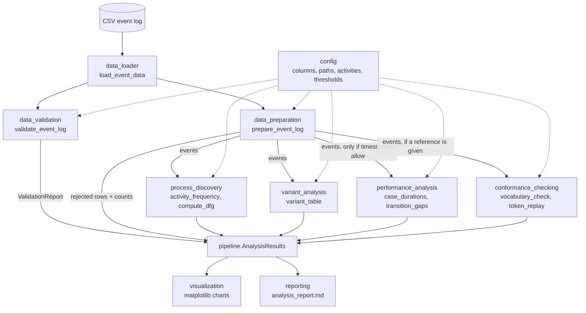

# Architecture

## Data flow

`pipeline.run_analysis` performs the calls above in order and returns an `AnalysisResults` object. `pipeline.write_outputs` turns that object into CSV tables, PNG charts and the Markdown report. `python -m healthcare_process_mining` is a thin command-line wrapper around both.

## Modules

| Module | Responsibility | Depends on PM4Py? |
|---|---|---|
| `config.py` | Column names, paths (relative to the project root), activity vocabulary, provenance options, thresholds | No |
| `data_loader.py` | Read CSV as text; clear errors for missing, empty or unsupported files | No |
| `data_validation.py` | Count data-quality problems; never modifies data | No |
| `data_preparation.py` | Rename columns, parse timestamps, apply rejection rules (keeping rejected rows), order events | No |
| `process_discovery.py` | Activity frequency, DFG, start/end activities (pandas); `EventLog` conversion and Petri-net discovery (PM4Py) | Only for nets |
| `variant_analysis.py` | Variant counts and shares | No |
| `performance_analysis.py` | Case durations, transition gaps, summaries, long-running cases | No |
| `conformance_checking.py` | Reference net construction, vocabulary check, token replay, precedence rules | Yes |
| `visualization.py` | Charts from computed results; optional Graphviz diagrams | Only for diagrams |
| `reporting.py` | Markdown report generated from `AnalysisResults` only | No |
| `pipeline.py` | Orchestration and output writing | Indirectly |
| `synthetic_data.py` | Seeded synthetic log with known rules and injected problems | No |

## Design decisions

- **pandas for counting, PM4Py for modelling.** Frequencies, DFGs, variants and durations are simple groupby operations. Writing them in pandas makes them transparent, easy to unit test and immune to PM4Py API changes, while PM4Py does what it is best at: Petri-net discovery and replay. The tests cross-check the pandas DFG against `pm4py.discover_dfg`.
- **Validation reports, preparation decides.** Validation never changes data. Preparation applies named rules and returns the rejected rows with their reasons, so the counts loaded, rejected and retained always add up.
- **Calculation separate from plotting.** Plot functions receive finished tables, so a chart cannot show a number that the report does not.
- **Explicit timestamp provenance.** The caller must say where timestamps came from before any timing result is produced.
- **PM4Py imported lazily** inside the functions that need it, so the core modules and most tests run quickly.
